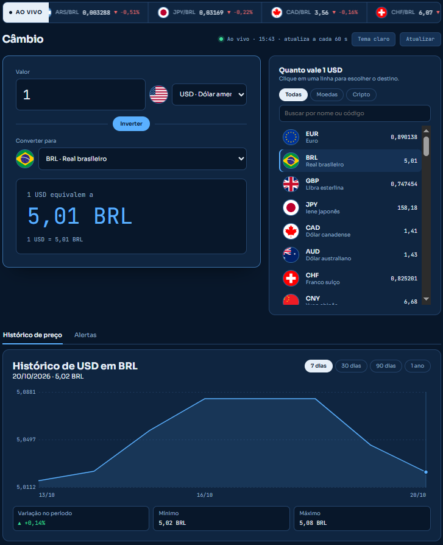

# Câmbio — conversor de moedas e criptomoedas

Conversor feito com **HTML, CSS e JavaScript puro** (sem frameworks), com cotações buscadas de APIs públicas.
Projeto de estudo para praticar DOM, eventos, `fetch` com `async/await`, `localStorage` e tratamento de falhas.

   
   
**Demo:** _(https://adalbertojr-code.github.io/conversor-de-moedas/)_

## Funcionalidades

- Conversão entre **40 moedas** e **22 criptomoedas** (dólar, euro, real, BTC, ETH, BNB…), com bandeiras e logos.
- **Faixa de cotações** rolando no topo, estilo telejornal, com a variação do dia.
- **Painel de cotações** com busca e filtro (moedas, cripto, todas).
- **Gráfico de histórico** (7 dias a 1 ano) desenhado em SVG, sem biblioteca, com eixos e leitura por mouse ou toque.
- **Alertas de preço**: avisa na página e por notificação do navegador quando um par passar de um valor definido.
- **Tema claro e escuro**, que segue o sistema e lembra a escolha.
- Preferências, alertas e a última cotação real ficam salvas no navegador (`localStorage`).
- Cotações que não estão ao vivo aparecem **marcadas como estimadas** (`~`), e alertas não disparam com elas.

## Como rodar

1. Baixe a pasta do projeto.
2. Abra o `index.html` no navegador (é preciso internet para buscar as cotações).
   Se preferir, use a extensão **Live Server** do VS Code.

## Testes

As contas ficam em `js/conversao.js`, separadas da interface, e têm testes próprios.

- No navegador: abra `tests/testes.html`.
- No terminal, na pasta do projeto: `node tests/testes.js`

## Estrutura

```
conversor-de-moedas/
├── index.html          estrutura da página
├── css/style.css       visual (tema claro e escuro por variáveis)
├── js/script.js        interface, chamadas às APIs, gráfico, alertas
├── js/conversao.js     funções de cálculo, sem tocar na página
└── tests/              testes das funções de conversao.js
```

## Como a conversão funciona

O código guarda quanto vale **1 unidade de cada ativo em dólar**. Qualquer par vira uma única conta:

```
resultado = quantidade × preço_em_USD(origem) ÷ preço_em_USD(destino)
```

Assim, BNB → EUR usa a mesma fórmula que USD → BRL.

## Fontes de dados

- Moedas com o real (dólar, euro, libra, entre outras): [AwesomeAPI](https://docs.awesomeapi.com.br/api-de-moedas), com cache de cerca de 1 minuto.
- Demais moedas: [Exchange Rate API](https://www.exchangerate-api.com) (open.er-api.com), atualizada uma vez por dia, com a [Frankfurter](https://frankfurter.dev) como plano B.
- Criptomoedas, logos e histórico de cripto: [CoinGecko](https://www.coingecko.com).
- Bandeiras: [Flagcdn](https://flagcdn.com).

Confira os termos de uso e as regras de atribuição de cada serviço antes de publicar.

## Limitações conhecidas

- **Valores informativos.** Não são recomendação de investimento nem cotação para operações financeiras.
- **Fontes misturadas.** Algumas moedas vêm de fonte quase em tempo real e outras de fonte diária. Em pares entre elas, pode haver uma pequena divergência de horário.
- **Alertas só funcionam com a página aberta.** A verificação acontece a cada 60 segundos, junto com a atualização das cotações; sem servidor, não há como avisar com o navegador fechado.
- **Limites das APIs gratuitas.** Se o limite de consultas for atingido, o gráfico ou as cotações podem ficar indisponíveis por alguns minutos. Nesse caso a página mostra a última cotação real salva, marcada como estimada.
- **Histórico limitado.** O gráfico depende de a fonte cobrir as duas moedas do par.
- Não foi testado em todos os navegadores. O tema usa `light-dark()` e `color-mix()` do CSS, que exigem navegadores recentes (Chrome 123 ou mais novo, ou equivalente).

## O que aprendi

- Buscar dados com `fetch` e `async/await`, tratando erros e respostas incompletas.
- Manter o estado em um objeto e redesenhar a tela a partir dele.
- Delegação de eventos, `localStorage`, notificações e formulários.
- Desenhar gráficos com SVG e pensar em hierarquia visual e acessibilidade.
- Separar a lógica (testável) da interface.
